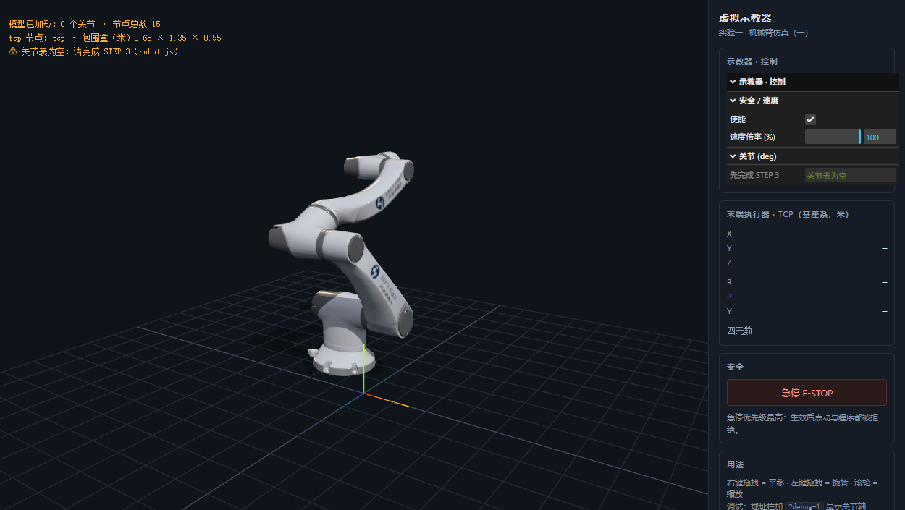
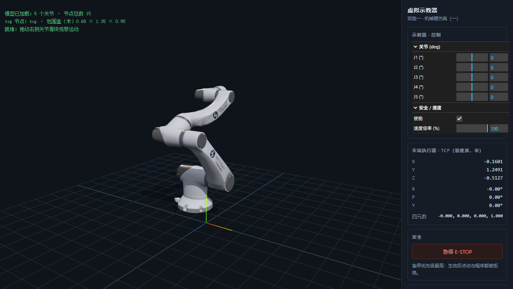

# 实验指导 · 上：环境、原理与模型导入（阶段 0–2）

> 对应讲义 P14–P18（开发工具链 / 场景树 / 素材解析 / URDF）；建议 2.5 学时。
> 配套工程：`lab1/`　配套数据：`01_素材核验报告.md`（448 行，本手册引用的每个数值都能在那里找到证据）
> 本阶段结束时要过 **关口 0 / 1 / 2**，见文末验收表。

---

## 0. 先看这张地图

```
阶段0 环境           阶段1 原理              阶段2 导入            阶段3 关节表
node server.js  →  变换/场景树/四元数  →  GLB+单位+节点树  →  traverse 建表 …（见中册）
   ↓ 关口0             ↓ 关口1                ↓ 关口2
页面能渲染、模型可见   能手算/能解释变换      包围盒=0.68×1.35×0.95 m，零位 TCP 对得上
```

默认假设：你已经会一点 JavaScript 和 Three.js 基础（你的 `E:\Workspace\GraphicAndAnimation` 里有 three.js 0.186 的本地副本和一个旧工程，本实验的 `lab1/vendor/` 就是从那里拷的，版本一致）——若不会，先花 20 分钟看 `lab1/src/main.js`，它只有 200 行、注释写满了"为什么"。

---

## 1. 阶段 0｜环境与最小回路（0.5 h）

### 1.1 启动三步

```bash
cd E:\Workspace\GraphicExperiment\lab1
node server.js          # 端口 8080；被占用就 set PORT=8081 && node server.js
```

浏览器打开 `http://localhost:8080`。看到：左侧机械臂 + 右侧示教器面板 + 左上角状态行。
想要"改代码 → 刷新 → 看效果"的回路，用 VS Code 打开 `lab1/`，改完按 F5 刷新即可（静态服务器不需要重启）。

**为什么不能双击 index.html**：ES Module 和 GLB 都要经过 `fetch`，`file://` 协议下被同源策略挡掉（讲义 P14）。这是本实验第一个必须亲手撞一次的错误——如果你不信，可以试着双击打开，然后在 DevTools Console 看报错，再回来看这段。

### 1.2 读代码：主循环里到底发生了什么

打开 `src/main.js`，只看三处：

1. **场景三件套**：`WebGLRenderer / Scene / PerspectiveCamera` + `OrbitControls`。相机参数 `(42°, aspect, 0.01, 100)` 对应你笔记里 `Project Transformation.md` 的 fov / aspect / near / far。
2. **加载**：`loadRobotModel()` 内部就三行——`GLTFLoader.loadAsync` → `gltf.scene` → `scale.setScalar(0.1)`。
3. **主循环**：`controls.update() → updateTelemetry() → renderer.render()`。
   关键认知：**Three.js 在 render 之前会沿场景树自动把每个节点的 `matrixWorld` 算出来**（`updateMatrixWorld`）。也就是说"每帧重算整条运动链的矩阵"这件事引擎替你做了，你只要把关节的**局部** rotation 改对。

### 1.3 关口 0（自检）

| 检查项 | 期望 |
|---|---|
| 页面无红色报错 | Console 只有 `[STEP 3 未完成]` 一条 warning |
| 状态行 | `模型已加载：0 个关节 · 节点总数 15`、`包围盒（米）0.68 × 1.35 × 0.95` |
| 模型外观 | 白色 Han's Robot 五轴臂，底座+大臂+小臂+腕部，**不是** 12 米高的巨物 |
| 包围盒口径 | 默认 `setFromObject(root)`，纵向 1.35 m；`precise=true` 时 1.2175 m，两者都正常 |
| 交互 | 左键旋转 / 右键平移 / 滚轮缩放 |

> 节点总数显示 15 而素材核验报告说 14：`traverse` 会把 `gltf.scene` 这层 Group 也数进去。



> 上图是**骨架状态**（STEP 3 还没做，所以状态行写"0 个关节"、TCP 面板是"—"）。
> 完成 5 个 STEP 后应达到下图：右侧 5 个关节滑块、TCP 读数 `(-0.1601, 1.2491, -0.5127)`、RPY 全 0。
>
> 

### 1.4 自测（口头答得上即可）

1. 主循环里 `updateTelemetry()` 放在 `renderer.render()` 之前还是之后？为什么都能工作？
2. 如果模型加载 404，你在 DevTools 的哪个面板第一步确认？状态行会显示什么？
3. `PerspectiveCamera` 的 `near/far` 与模型尺寸差一个数量级会发生什么（提示：0.01 与 100 是给"米"准备的，若模型是 13.5 米高）？

---

## 2. 阶段 1｜先补认知：变换、场景树、四元数（1 h）

### 2.1 复习清单（按你现有笔记）

**必复习（约 40 分钟）**

| 顺序 | 笔记 | 先看哪几节 | 为什么本实验绕不开 |
|---|---|---|---|
| 1 | `E:\Workspace\Games101\线性代数\3D Transformation.md` | 「0. 为什么是 4×4 齐次矩阵」→「5. 绕任意轴：Rodrigues」→「3. 关键性质」 | `setJoint` 就是 Rodrigues 的一次应用；`R_fix` 是常量旋转 |
| 2 | `E:\Workspace\Games101\线性代数\Transformation.md` | 「Homogeneous coordinates」→「书写顺序 vs 作用顺序（从右往左）」→「TRS」 | `matrixWorld = 父 × 局部` 的左右顺序；本实验最高频错误 |
| 3 | `E:\Workspace\Games101\Animation.md` | 「Forward Kinematics」「Inverse Kinematics」两节（其余可跳） | FK/IK 术语；但只有概念，公式要补 |

**必须先补的 3 个空白（P0，笔记里没有）**
1. 《场景树与父子变换：从 Object3D 到 matrixWorld》
2. 《四元数、RPY 与万向节锁》——你的笔记里「# 四元数」只有标题没有正文
3. 《GLTF/GLB 与 URDF 资产管线》

详细对照表（36 个知识点逐条分类）在 `02_Games101笔记对应.md`。**注意**：那份文件只给大纲，正文要你自己写——本实验所有"讲原理"的部分都会引用它，不构成替你记笔记。

### 2.2 四条必须能默写的结论

**结论 1：位姿 = 4×4 齐次变换，位置在第 4 列**

```
T = [ R  p ]      p = 位置（本实验单位：米）
    [ 0  1 ]      R = 3×3 旋转
```

**结论 2：连乘顺序 = 从右往左作用，父子递推 = 父 × 局部**

```
v_world = T_root · T_J1 · T_link1 · T_J2 · … · T_tcp · v_local
T_world(child) = T_world(parent) · T_local(child)
```
Three.js 的 `matrixWorld` 就是左边那个乘积，`matrix` 是右边的局部变换。

**结论 3：关节驱动 = 在"静止旋转"上右乘一个绕局部轴的旋转**

```
R_joint(θ) = R_fix · R_axis(θ)          ← R_fix = 零位四元数 qZero，R_axis = Rodrigues
q = qZero.multiply(q_axis(θ))           ← Three.js 里"右乘"就是控制局部坐标系的旋转
```
右乘 = 绕**已转动后**的局部轴；左乘 = 绕**世界/父**轴。用错方向，五个关节会一起歪 90°。

**结论 4：RPY 只负责给人看，内部一律用四元数/矩阵**

欧拉角在 ±180° 附近不连续、存在万向节锁；插值与传递用四元数，只在"显示"这一层转 RPY（`Euler.setFromQuaternion`）。

### 2.3 讲义 P07 的"三级分解"其实就是在说结论 3

每个关节节点只做三件事（本素材完全按这个设计导出）：

| 级别 | 内容 | 是否常量 | 在本素材里是谁 |
|---|---|---|---|
| ① 纯平移 t_j | 枢轴在父节点系中的位置 | 常量 | GLB 关节节点的 `position` |
| ② 定轴 R_fix | 让局部 +Y（Blender 的 +Z）对准运动轴 | 常量 | GLB 关节节点的 `quaternion` → `qZero` |
| ③ 关节角 Z(θ) | 绕局部轴转，**唯一变量** | 变量 | 你写的 `setJoint` |

所以你的 `setJoint` 只有两行数学：`clamp` + `qZero · R(θ)`。剩下的全交给场景树。

### 2.4 自测

1. 若 `R = R_fix · R(θ)`，那"绕世界 Y 轴转"应该写在左边还是右边？
2. `node.matrixWorld` 是"父 × 局部"还是"局部 × 父"？用 2 个节点的例子验证。
3. 为什么 `setRotationFromAxisAngle(axis, θ)` 在这里是错的？（提示：它覆盖 `quaternion`，而不是叠加）

---

## 3. 阶段 2｜模型导入与素材事实卡（1 h）

### 3.1 素材清单：先认清"哪几个文件是当前模型的"

| 文件 | 内容 | 能用吗 |
|---|---|---|
| `assets/robot_articulated.glb` | 场景树 + 网格 + 材质（11.7 MB，glTF 2.0） | ✅ 唯一运行时模型 |
| `assets/joint_map.json` | 关节约定 + 限位 + （旧）位姿 | ✅ 限位/约定的来源 |
| `assets/robot_spec.yaml` | 人读规格 | ⚠ **旧模型残留**，别用来对拍 |
| `assets/robot.urdf` | ROS 交换格式 | ⚠ **旧模型残留**，且缺 `tcp` link、无 visual mesh；本环境也没有 URDFLoader |
| `Materials/.../joint_map.json.pre-fix.bak` | 改版前备份 | 仅供考古，不用 |
| `_glb_dump.json` | 旧 GLB 的导出转储 | 仅供考古，不用 |

**结论：只有 GLB 和 joint_map.json 描述当前模型。** 讲义 P17 让你用 URDF 那个例子理解 joint 的四要素即可，**不要**真的去加载 URDF（素材没有 mesh，且 three.js 0.186 的 addons 里没有 URDFLoader.js）。

### 3.2 真实场景树（14 节点，和讲义 P16 的"13 节点链"有出入）

```
robot-arm  (scene root, 空节点, T=(-0.5276, 0, -4.5600))
├─ J1 ── link_1 ── J2 ── link_2 ── J3 ── link_3 ── J4 ── link_4 ── J5 ── link_5 ── link_flange ── tcp
└─ link_base            ← 注意：link_base 是 root 的第二个孩子（网格叶子），不是 J1 的父！
```

- `J1…J5`：**空节点**，只承载"枢轴位置 + 静止旋转"，是你要驱动的对象；
- `link_base / link_1 … link_5 / link_flange`：挂网格的节点（`link_flange` 是空节点）；
- `tcp`：空节点，局部变换 = **单位阵**（和法兰重合，见 3.5 陷阱 D）；
- 6 个 mesh 合计 6227 顶点 / 8227 三角，1 个 PBR 材质 + 3 张贴图（baseColor / normal / AO-roughness）；
- **所有 14 个节点的 `extras` 都是空的**——即 `node.userData` 只有 `{ name }`。

### 3.3 单位与坐标系：本实验最大的两个"隐形坑"

**坑 A：单位是"分米"，要乘 0.1 才是米。**
模型高 13.5052 单位 → 真实 5 轴臂高约 1.35 m；缩放 0.1 后包围盒：

```
min = (-0.4490, 0.1095, -0.5301)   max = (0.2360, 1.4601, 0.4164)   单位 m
size = ( 0.6850, 1.3505,  0.9465)
```

> **包围盒有两种口径，别被第二个数字吓到**：上面这组是 `new THREE.Box3().setFromObject(root)` 的**默认**结果（把每个 mesh 的局部 AABB 的 8 个角点变换后再取包络，偏保守）；若写 `setFromObject(root, true)` 逐顶点精确计算，纵向会得到 `1.2175 m`（总尺寸 `0.6850 × 1.2175 × 0.9465`）。两者都正确，本实验统一用**默认口径**（与 `main.js` 一致），验收看 `1.35`。详见 `01_素材核验报告.md` §4.4 / §7.1b。

不缩放的话，位姿面板会显示 `Y=12.49`（"12 米高的机械臂"），讲义 P26 写"单位 m"会骗你直接信。

**坑 B：基座底面在 y = +0.1095 m，模型是"悬空"的。**
这不是你的 bug，是素材原点不在基座安装面（也可理解为"装在一个 11 cm 高的安装座上"）。**不要**用平移去"修正"它——一平移，所有世界坐标读数都会整体变；报告里如实记录坐标系即可（要做到"底座落地"就加一层 Group 在显示层平移，并在报告里声明）。

**坑 C：joint_map.json 的位置量是 Blender 的 Z-up，GLB 是 glTF 的 Y-up。**
换算公式（记熟，标定/对拍都要用）：

```
glTF (x, y, z) = Blender (x, z, -y)        Blender (x, y, z) = glTF (x, -z, y)
```

例：`joint_map.joints[0].pivot_world = (2.32509, 0.72649, 4.462912)` → glTF 世系 `(2.3251, 4.4629, -0.7265)`，乘以 0.1 就是 `(0.2325, 0.4463, -0.0726)` m——正是 J1 的轴心。

### 3.4 零位事实（后面每一关都要拿它当基准）

| 关节 | 零位世界转轴（局部 +Y） | 零位轴心（m） | 限位（°） |
|---|---|---|---|
| J1 | (−1, 0, 0) | (0.2325, 0.4463, −0.0726) | ±180 |
| J2 | (+1, 0, 0) | (−0.3362, 0.9231, 0.3313) | ±120 |
| J3 | (0, 0.4695, −0.8829) | (−0.1717, 0.8841, 0.4052) | ±120 |
| J4 | (−1, 0, 0) | (0.1169, 1.2465, −0.2697) | ±120 |
| J5 | (0, 0, +1) | (−0.1602, 1.2484, −0.5184) | ±180 |

**全零位末端 TCP 世界位姿（本实验第一把"标尺"）：**

```
position = (-0.1601, 1.2491, -0.5127)  m
quaternion = (0, 0, 0, 1)              单位四元数
RPY(XYZ)  = (0°, 0°, 0°)
```

推导链：`qZero` 的连乘在 tcp 处正好抵消成单位阵——这不是巧合，是素材作者把"零位 = 导出静止姿态"设计成 tcp 朝向与世界系对齐。你后面做 FK 验证时，第 1 档就查这 7 个数。

> 想看物理意义：J1/J2/J4 都是 ±X 轴（肩、肘、腕俯仰），J3 是"前倾 28°"的肘横摆（sin28°=0.4695），J5 是沿 +Z 的法兰卷绕。**判据：J5 转任意角度，TCP 位置必须不变**（实测变化 < 0.3 mm）——这一条可以把"+Z 轴错误"当场抓出来。

### 3.5 讲义与本素材的 10 处不一致（报告里必须写明你以哪个为准）

| # | 讲义位置 | 讲义说法 | 素材实际 | 处理 |
|---|---|---|---|---|
| 1 | P18/P23 代码 | `node.userData.joint === true`、`userData.axis/limit` | GLB 无 extras → 拿到 0 个关节 | 改按 `getObjectByName('J1'…)`，限位读 joint_map |
| 2 | P16 表 | J1 限位 ±120、J3 限位 ±90 | J1 ±180、J3 ±120（joint_map + GLB 一致） | 以 joint_map 为准 |
| 3 | P16 表 | "连杆长" 6.54/8.45/1.85/8.19/3.72 | 这是相邻关节轴心距离（单位 0.1 m），不是 DH 参数 | 当"臂长"用，不要当 DH |
| 4 | P19 表 | UR5 六个关节限位 | 本模型是 Han's 五轴：5 个关节 | 只把 P19 当"限位怎么钳"的示例 |
| 5 | P20 清单 | "6 个关节滑块" | 5 个 | 按 5 个做 |
| 6 | P08 表 | J1/J2/J4 共线 ±X | ✅ 吻合 | J3/J5 的值与表不符（表来自旧模型） |
| 7 | P05 图注 | "按连杆分色" | 全模型只有 1 个材质 | 不影响，报告里注明 |
| 8 | P16 链 | 13 节点、link_base→J1 | 14 节点，link_base 是 root 的兄弟叶子 | 遍历时别假设"单链" |
| 9 | joint_map.convention | "绕节点局部 +Z" | 这是 Blender 语言；glTF/Three.js 里是**局部 +Y** | 见阶段三 |
| 10 | joint_map.tcp | `offset_local = (0,0,1.336006)` | 旧模型残留；当前 GLB 的 tcp 与法兰重合 | 别照它加 13.36 cm 偏移 |

### 3.6 动手：把"事实"变成"你自己的检查"

在 Console（或临时改 `main.js`）里做三件事，把输出记到实验记录里：

```js
// ① 打印整棵树（名字 + 类型 + 子节点数）
__LAB__.robot.traverse(o => console.log('  '.repeat(depth(o)), o.name, o.type, o.children.length));

// ② 量尺寸（Box3）
new THREE.Box3().setFromObject(__LAB__.robot)      // 期望 0.685 × 1.3505 × 0.9465

// ③ 验证"网格已烘焙"：link_1 的局部矩阵是不是单位阵？
__LAB__.robot.getObjectByName('link_1').matrix.elements
```

（`THREE` 没暴露到全局的话，把 `THREE` 也挂到 `window`，或在 `main.js` 里临时 `window.THREE = THREE`。）

### 3.7 关口 2（验收）

| 检查项 | 通过标准 |
|---|---|
| 场景树 | 能画出 14 节点图（含 link_base 是兄弟这一笔），能说出 5 个关节节点是空节点 |
| 单位 | 能解释 `scale=0.1` 的依据（包围盒 / 真实臂尺寸），能报出三个尺寸 |
| 坐标系 | 能默写 glTF↔Blender 换算公式，并用人话解释"为什么 +Z 变成 +Y" |
| 零位基准 | 能说出 TCP 零位位置 7 个数字，以及"为什么 RPY=0" |
| 陷阱 | 能说出 3.5 表里任意 3 条不一致，并说明你以哪个文件为准 |

### 3.8 自测

1. 为什么 `link_base` 是根的第二个孩子，而不是 J1 的父？这对"遍历建表"有没有影响？
2. 如果把 `modelScale` 改成 1，除了"模型巨大"，还有哪两处数值会跟着错？
3. `joint_map.joints[0].pivot_world` 换成米是多少？和 `getWorldPosition(J1)` 差多少？

---

## 附录 A｜素材事实卡（打印/抄进报告）

```
模型    robot_articulated.glb  glTF 2.0, Blender I/O v5.2.40, 11,711,164 B
规模    14 节点（8 空 + 6 网格）/ 6 mesh / 6227 顶点 / 8227 三角 / 1 材质 3 贴图 / 无动画无骨骼
根      robot-arm  T=(-0.5276, 0, -4.5600)（模型单位）
链      robot-arm → J1 → link_1 → J2 → link_2 → J3 → link_3 → J4 → link_4 → J5 → link_5 → link_flange → tcp
兄弟    link_base（root 的第二孩子，网格叶子）
元数据  节点 extras 全空 → 无 userData.joint/axis/limit
单位    1 单位 = 0.1 m；包围盒 0.6850 × 1.3505 × 0.9465 m；min.y = +0.1095 m
零位    TCP = (-0.1601, 1.2491, -0.5127) m，q=(0,0,0,1)，RPY=(0,0,0)
轴      关节角 = 绕节点**局部 +Y**（右手定则）；驱动 q = qZero · Ry(θ)
限位    J1 ±180 / J2 ±120 / J3 ±120 / J4 ±120 / J5 ±180（deg）
判据    J5 转动时 TCP 位置不变（<0.3 mm）
旧代    robot_spec.yaml / robot.urdf / _glb_dump.json / *.pre-fix.bak 均为旧模型，勿对拍
```

## 附录 B｜自测参考答案要点

- **1.4-1**：写在 render 之前，因为 `matrixWorld` 在 render 时才自动刷新；若在 render 之后读，读到的是上一帧的矩阵。
- **1.4-2**：Network 面板看 404；状态行会停在"加载模型…"或显示 `启动失败：…`。
- **1.4-3**：near/far 是相对相机距离的裁剪面；模型大 10 倍会超出 far 或近平面裁剪，出现"模型一半被切掉/闪烁"（z-fighting）。
- **2.4-1**：绕世界/父轴转写左边（左乘），绕局部轴写右边（右乘）。
- **2.4-2**：父 × 局部。用两级链 `T0·T1` 手工乘一遍即可验证。
- **2.4-3**：`setRotationFromAxisAngle` 直接赋值 `quaternion`，丢掉 `R_fix`，等价于把静止姿态清零。
- **3.8-1**：导出时把底座网格单独挂在根下（几何不需要关节变换）；对遍历建表无影响，但"整棵树都是单链"的假设是错的。
- **3.8-2**：位姿面板的 x/y/z 会大 10 倍；相机取景/裁剪面与网格地面比例也会错；包围盒尺寸大 10 倍。
- **3.8-3**：`(0.2325, 0.4463, -0.0726)` m，与 `getWorldPosition` 一致（差 < 1e-6）。
