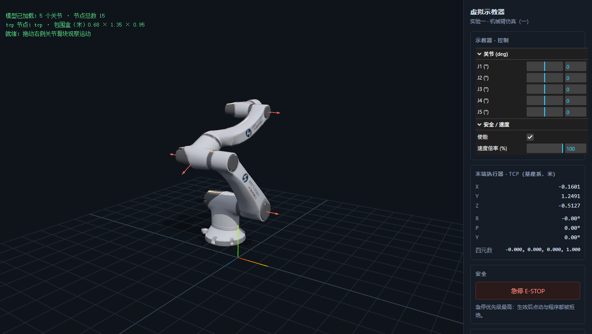

# main.js 逐段导读（实验一 · 工程骨架）

> 文件：`lab1/src/main.js`（212 行）
> 目标：读完你能回答——“每一段为什么存在、数据从哪来到哪去、改哪一行会发生什么”，并且知道**你的代码要接在哪几行**。
> 这不是逐行翻译，而是**按运行顺序 + 数据流**读代码的方法示范。配套自测题在 §7。

---

## 0. 先学方法：读一份陌生代码的 5 个问题

1. **入口在哪？** 谁先执行、什么时候加载完？（这份文件：`animate()` 与 `boot()` 在最后两行启动）
2. **数据长什么样？** 核心对象是什么、谁有权改？（`state` 是唯一事实源）
3. **每帧在做什么？** 渲染循环里三步各管什么？（控制 → 遥测 → 渲染）
4. **边界条件呢？** 模型没加载完、节点找不到、TODO 没实现时会不会崩？（多处降级与 `throw`）
5. **哪里可疑？** 未使用的变量、与文档不符的常量、顺序依赖（本文有 3 处，见 §5）

带着这 5 个问题往下读，比从第 1 行抠到第 212 行有效得多。

---

## 1. 全景：模块边界与生命周期

```
index.html
 ├─ importmap：把裸模块名 "three" 映射到 ./vendor/three/three.module.js
 └─ <script type="module" src="./src/main.js">   ← 入口
        │
        ├─ import { CONFIG }            config.js       常量（模型路径、缩放、关节名）
        ├─ import { loadRobotModel, loadJointMap, buildJointTable, setJoint, readTCPPose }  robot.js
        │                                   ↑ buildJointTable / setJoint / readTCPPose 是你的 TODO
        └─ import { bindTeachPendant }   ui.js           ↑ 里面的关节滑块也是你的 TODO
```

运行时间线：

```
模块求值（顶层代码同步执行）
  ├─ 建 state / renderer / scene / camera / 灯光 / 地面
  ├─ 注册 resize、急停 事件
  ├─ animate()      ← 立刻启动渲染循环（此时模型还没到！）
  └─ boot()         ← 异步：加载 GLB → 建表 → 绑 UI → 更新状态行
        每帧：controls.update() → updateTelemetry() → renderer.render()
```

**关键认知：渲染循环比模型先跑起来。** 所以 `updateTelemetry()` 第一行必须是 `if (!state.tcp) return;`，否则加载完成前每帧都会抛错。

---

## 2. §① 渲染器 / 场景 / 相机（L34–L57）

```js
const renderer = new THREE.WebGLRenderer({ antialias: true });   // 拿到 WebGL 上下文 + canvas
renderer.setPixelRatio(Math.min(window.devicePixelRatio, 2));    // 物理像素 / CSS 像素
renderer.setSize(viewport.clientWidth, viewport.clientHeight);   // CSS 尺寸
renderer.outputColorSpace = THREE.SRGBColorSpace;                // 输出到 sRGB
renderer.shadowMap.enabled = true;
renderer.shadowMap.type = THREE.PCFShadowMap;
viewport.appendChild(renderer.domElement);                       // 把 canvas 插进页面
```

| 行 | 在做什么 | 为什么这么写 | 对应你的课程 |
|---|---|---|---|
| `antialias` | 开启 MSAA | 白色机械臂的斜边不锯齿 | Rasterization / Antialiasing |
| `setPixelRatio(min(dpr,2))` | 渲染分辨率 = CSS 尺寸 × 像素比 | 高清屏不糊；上限 2 防止 4K/5K 屏爆显存 | — |
| `outputColorSpace = SRGB` | 渲染结果做 sRGB 编码 | 不做的话画面发灰/发暗 | Color and Perception |
| `shadowMap` | 阴影贴图与过滤方式 | PCF 是"软阴影"的常见折中 | RayTracing / Shadow Mapping |

相机：

```js
const camera = new THREE.PerspectiveCamera(fov, aspect, near, far);
```

这四个参数就是你笔记里**透视投影矩阵**的四要素——`Project Transformation.md` 里 `M_proj` 的 fov/aspect/near/far。**aspect 写错或窗口变了不更新，模型就被拉伸**（见 §6 实验 3）。

`OrbitControls`：把"鼠标拖动 → 相机环绕"这类交互封装好。注意 `enableDamping = true` 后**必须每帧 `controls.update()`**，否则松手后的惯性不生效（见 §4 主循环）。

## 3. §① 灯光与地面（L59–L86）

```js
scene.add(new THREE.HemisphereLight(0xdfe9ff, 0x1a2230, 1.8));  // 天空色 / 地面色 / 强度 ≈ 环境光
const keyLight = new THREE.DirectionalLight(0xffffff, 2.2);      // 主光（平行光，太阳）
keyLight.position.set(2.5, 4, 2);
keyLight.castShadow = true;
keyLight.shadow.mapSize.set(2048, 2048);                         // 阴影贴图分辨率
keyLight.shadow.camera.near = 0.1;  ... far = 12; left/right/top/bottom = ±2;
```

- **HemisphereLight**：不是真正的环境光积分，但两个颜色（天/地）能让白色机身上暗部下亮下暗，比纯 AmbientLight 更像样。
- **DirectionalLight 的阴影相机是正交相机**：`left/right/top/bottom` 就是它的视锥。**必须把模型包在 ±2 m 内**，否则阴影被裁掉或精度很差；`far = 12` 要盖住光源到地面的距离。
- **阴影三件套**缺一不可：光源 `castShadow`、网格 `castShadow`（`boot()` 里 `traverse` 设置的）、地面 `receiveShadow`。

```js
const grid = new THREE.GridHelper(4, 20, ...);      // 只是线，不接收阴影
const ground = new THREE.Mesh(new THREE.PlaneGeometry(4, 4),
                              new THREE.ShadowMaterial({ opacity: 0.25 }));
ground.rotation.x = -Math.PI / 2;                   // 平面默认在 XY 面，绕 X 转 -90° 才水平
ground.receiveShadow = true;
scene.add(new THREE.AxesHelper(0.3));               // 世界轴：红X / 绿Y / 蓝Z
```

`rotation.x = -π/2` 是**旋转矩阵**的直接应用：平面默认法线朝 +Z，要让它朝 +Y 就得绕 X 轴转 −90°（`Transformation.md` 的 TRS 顺序，这里只有 R）。`ShadowMaterial` 是"只画阴影、表面透明"的材质，避免地面盖住网格。

## 4. 取景、关节轴、主循环、遥测、自适应、急停（L88–L162）

### 4.1 frameCamera（L88–L99）

```js
const center = box.getCenter(new THREE.Vector3());
const size   = box.getSize(new THREE.Vector3());
const dist   = Math.max(size.x, size.y, size.z) * 2.1;
camera.position.set(center.x + dist*0.72, center.y + dist*0.30, center.z + dist*1.05);
controls.target.copy(center);      // 旋转围绕模型中心，而不是世界原点
controls.update();
keyLight.target.position.copy(center);
scene.add(keyLight.target);        // ★ 忘了这句，target 不参与 matrixWorld 更新
```

- 用包围盒自动取景，就不用为每个模型手调相机。
- `controls.target` 决定"环绕中心"；不改的话模型会绕原点甩。
- **`keyLight.target` 必须 `add` 进场景**，否则它的 `matrixWorld` 不会更新，平行光方向按默认原点算——这是个经典坑。

### 4.1b showJointAxes（L101–L115）：从局部轴到世界轴（附一个真 bug 的教训）

```js
j.node.getWorldQuaternion(q);                    // 关节当前的世界姿态
const dir = new THREE.Vector3(0, 1, 0)           // ★ 局部 +Y 才是本素材的转轴
  .applyQuaternion(q).normalize();               // 局部方向 → 世界方向
scene.add(new THREE.ArrowHelper(dir, p, len, 0xff5f56, ...));
scene.add(new THREE.ArrowHelper(dir.clone().negate(), p, len, 0xff5f56, ...));  // 两个方向都画
```

- `applyQuaternion` 就是"用旋转矩阵作用在一个方向向量上"（`v' = R · v`），比手写矩阵直观。
- 转轴画成双向箭头，因为关节角可正可负，看方向比看箭头头更有用。



> 修好后的 `?debug=1`：五根红箭头就是真实转轴（J1/J2/J4 沿世界 X 轴、J3 前倾 28°、J5 沿世界 Z 轴），它们都垂直于各自下游连杆的旋转平面。你可以用它检查自己实现的 `buildJointTable` 是否把轴取对了。
- **这里原本写的是 `(0, 0, 1)`，是个真 bug**：素材的关节轴是**局部 +Y**（Blender 的 +Z 经 glTF Y-up 重标定而来），所以早期版本画出的红箭头全部与真实转轴垂直 90°。它不影响渲染，但会把你带进"轴到底在哪"的沟里。教训：**调试可视化本身也可能错**，横轴/纵轴的判断永远要靠数值验证（J5 转动时 TCP 不变、单关节期望位姿表）。

### 4.2 updateTelemetry（L117–L136）

```js
if (!state.tcp) return;                 // 模型还没加载完
const pose = readTCPPose(state.tcp);    // ← robot.js 的 TODO(STEP 5)
if (!pose) { 显示 "—"; return; }        // TODO 没实现时降级，不崩
$('pos-x').textContent = pose.position.x.toFixed(4);
...
$('rpy-r').textContent = (pose.rpy.r * R2D).toFixed(2) + '°';   // 弧度→度只在显示层
```

- **单位与格式只在显示层处理**：内部一律米/弧度，界面才转度和四舍五入（避免"毫米/度"混进计算）。
- 每帧刷新 DOM：4+3+1 个 `textContent` 赋值，成本可忽略；但真实项目里会更谨慎（一块 DOM 批量更新）。

### 4.3 主循环（L138–L144）

```js
function animate() {
  requestAnimationFrame(animate);   // ① 预约下一帧
  controls.update();                // ② 阻尼惯性
  updateTelemetry();                // ③ 读位姿 → 写 DOM
  renderer.render(scene, camera);   // ④ WebGL 绘制（内部会 updateMatrixWorld）
}
```

三个顺序问题，值得想清楚：

1. **为什么 `requestAnimationFrame` 写第一行？** 先预约下一帧，再做本帧工作，避免本帧抛错导致循环停摆。
2. **`renderer.render` 内部会 `scene.updateMatrixWorld()`**：这就是"每帧自动重算整条运动链矩阵"的地方，也是讲义说"FK 由渲染管线免费完成"的实现位置。
3. **`updateTelemetry` 在 render 之前，为什么也能读到最新位姿？** 因为 `getWorldPosition/Quaternion` 内部会主动 `updateWorldMatrix(true, false)` 刷新祖先链。因此"先读后渲"读到的就是当前帧的位姿，不是上一帧的。

### 4.4 窗口自适应（L146–L153）

```js
camera.aspect = w / h;
camera.updateProjectionMatrix();   // ★ 不调用它，改了 aspect 也不生效
renderer.setSize(w, h);
```

投影矩阵是**缓存的**，改参数后必须显式重算 → 这就是 `updateProjectionMatrix()` 的作用（对应笔记里 `M_proj` 由参数生成）。

### 4.5 急停按钮（L155–L162）：事件与状态解耦

```js
$('estop').addEventListener('click', () => {
  state.estop = !state.estop;                       // 只改状态
  $('estop').classList.toggle('on', state.estop);   // 只改外观
  setStatus(state.estop ? '⚠ 急停生效：…' : '急停已解除', state.estop ? 'bad' : 'ok');
});
```

注意它**没有直接停任何东西**——真正的"拒绝运动"发生在 `ui.js` 的滑块回调和（阶段 7 的）程序执行器里：`if (state.estop) return;`。这是事件驱动 + 状态驱动的分工：按钮负责改状态，运动逻辑负责读状态。好处是新增一个"程序执行"入口时，不用再改急停代码。

## 5. §② 启动流程 boot（L164–L200）：异步与接口

```js
setStatus('加载模型 …');
const { scene: robot, box, size } = await loadRobotModel();   // 解构重命名 scene → robot
robot.traverse(o => { if (o.isMesh) { o.castShadow = true; o.receiveShadow = true; } });
scene.add(robot);
state.robot = robot;
console.log('[阶段二] 模型包围盒 size(m) =', ...);              // 单位自检
frameCamera(box);
const jointMap = await loadJointMap();                         // 读 joint_map.json
state.joints = buildJointTable(robot, jointMap);               // ← TODO(STEP 3)
state.tcp = robot.getObjectByName('tcp');
if (!state.tcp) throw new Error("场景树里找不到 'tcp' 节点");   // 加载期关口
state.robot.updateMatrixWorld(true);                           // 立刻刷新一次矩阵
if (new URLSearchParams(location.search).get('debug') === '1') showJointAxes();
state.gui = bindTeachPendant(state);                           // ← TODO(STEP 6) 在 ui.js 里
setStatus(`模型已加载：${state.joints.length} 个关节 · 节点总数 ${countNodes(robot)}…`);
```

要点：

- **`await` 串行**：模型 → joint_map → 建表 → 绑 UI，顺序有依赖（UI 需要 joints）。
- **`throw` 是好事**：tcp 节点找不到就立刻停，而不是带着半成品跑（讲义 P18 的 `validateAgainstMap` 同思路）。
- **`updateMatrixWorld(true)`**：刚建完表/改完关节后立即刷新一次，保证第一次遥测就正确（之后每帧由 render/ getWorldPosition 维护）。
- **`countNodes` 会多算 1**：`traverse` 包含 `gltf.scene` 这层 Group，所以 14 个模型节点显示 15。
- **状态行是给学生的"体温计"**：`ready = joints.length === 5` 区分"骨架态"与"完成态"。

## 6. 三处顺序/依赖陷阱（读代码时最值得抓的东西）

| # | 陷阱 | 现象 | 正确做法 |
|---|---|---|---|
| 1 | `animate()` 在 `boot()` 之前 | 模型未到就渲染 | `if (!state.tcp) return` 之类的守卫 |
| 2 | `updateTelemetry()` 的位置 | 看似"读上一帧" | 其实 `getWorldPosition` 会主动刷新祖先；先读后渲语义更清楚 |
| 3 | `keyLight.target` 没 add 进场景 | 阴影方向/范围诡异 | target 也必须是场景里的节点 |

## 7. 自测（先答再看答案）

1. `renderer.setPixelRatio(2)` 和 `renderer.setSize(800,600)` 分别控制什么？为什么像素比要取 `min(dpr, 2)`？
2. 窗口拉宽后模型被拉胖，是哪一步漏了？
3. 为什么 `frameCamera` 里要改 `controls.target`？不改会怎样？
4. `updateTelemetry()` 放在 `renderer.render()` 之前，读到的位姿是当前帧还是上一帧？依据是什么？
5. `boot()` 里为什么要有 `state.robot.updateMatrixWorld(true)`？不写会怎样？
6. `ground.rotation.x = -Math.PI/2` 在数学上做了什么？如果把平面换成 BoxGeometry，还需要它吗？
7. `state` 为什么要做成一个对象，而不是散落的全局变量？
8. 文件里有哪些"无用代码/预留代码"？（提示：`const tmp`、`setJoint` 的 import）

**参考答案要点**

1. 像素比 = 物理像素/CSS 像素；size 是 CSS 尺寸；上限 2 是性能/显存折中，超过 2 肉眼收益很小。
2. `camera.updateProjectionMatrix()`（只改 `aspect` 不够）。
3. 决定 OrbitControls 环绕中心；不改则绕世界原点转，模型会飞出画面。
4. 当前帧——`getWorldPosition` 内部 `updateWorldMatrix(true,false)` 会沿父链刷新。
5. 首次建表后让 matrixWorld 立即正确，避免第一帧遥测读到单位阵；不写通常也能被下一次读取纠正，但状态行/截图可能早一拍。
6. 绕 X 轴转 −90°，把 XY 平面的法线从 +Z 转到 +Y（水平）；BoxGeometry 本身是 3D 体块，不需要这步。
7. 单一事实源：ui、遥测、程序执行、急停都读写同一份状态，避免不一致；也便于 `window.__LAB__` 调试。
8. `const tmp = { p: new THREE.Vector3() };`（未使用）、`setJoint` 的 import（main.js 没用，预留给阶段 7 的程序执行；也可以在 ui.js 里用）。

---

## 8. 你要接在哪几行（TODO 映射）

| 你的文件/函数 | 被 main.js 调用的位置 | 返回什么 | 对应阶段 |
|---|---|---|---|
| `robot.js → buildJointTable()` | L185 | 5 个 `{name,node,axis,lower,upper,angle,qZero}` | 阶段 3 |
| `robot.js → setJoint()` | 由 `ui.js` 调用（main 不直接调） | 改 `node.quaternion` + `joint.angle` | 阶段 4 |
| `robot.js → readTCPPose()` | L121（每帧） | `{position, quaternion, rpy}` 或 `null` | 阶段 5 |
| `ui.js → bindTeachPendant()` | L190 | `GUI` 实例 | 阶段 4 |
| `analysis.js` 两个类 | 阶段 7/8 你自己接到主循环/按钮 | 轨迹 CSV / 点云 | 阶段 7–9 |

---

## 9. 六个动手实验（改坏 → 观察 → 复现 → 原样改回）

> 每个都别只看，动手改一次，把"现象 + 原因"记进实验记录（报告 §8 的踩坑记录可以直接用）。

1. **删掉 `renderer.setPixelRatio(...)`**：高分屏上模糊；解释 `devicePixelRatio`。
2. **注释掉 `camera.updateProjectionMatrix()`**，把窗口拉宽 → 模型变胖；恢复后解释"投影矩阵缓存"。
3. **把 `ground.rotation.x = -Math.PI/2` 改成 `0`** → 地面竖起来挡住视线；解释 Plane 的默认朝向。
4. **删掉 `controls.target.copy(center)`** → 拖动时模型绕世界原点甩；解释 target 的作用。
5. **把 `updateTelemetry()` 移到 `renderer.render()` 之后** → 视觉几乎无差别；给两个函数加 `performance.now()` 打印，解释为什么（§7-4）。
6. **在 `animate()` 里 `state.joints[0] && setJoint(...)` 做一次正弦摆动** → 模型开始动；体会"每帧改局部旋转 → 引擎连乘矩阵"的闭环（先把 `setJoint` 的 import 用起来；做完删掉）。

---

## 10. 读代码通用清单（以后读别人的代码也用）

- 先找入口（`animate()` / `boot()` / 事件注册），再找状态（`state`），最后才逐行。
- 每个 `addEventListener` 都是一个"外部世界 → 程序"的入口，单独看。
- 每个 `await` 前后，问"这期间画面在做什么？用户能不能操作？"。
- 画一张数据流图：`GLB → 场景树 → matrixWorld → 遥测 → DOM`。
- 对每个常量问"为什么是这个数"（`2.1`、`2048`、`±2`、`0.25`），答不上来就可能是抄的。
- 标出"死代码 / 预留 / 降级 / 强制失败"四类语句，它们说明作者对边界的态度。
